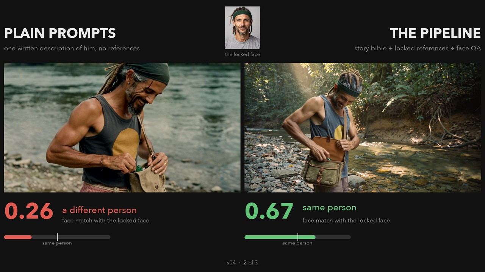
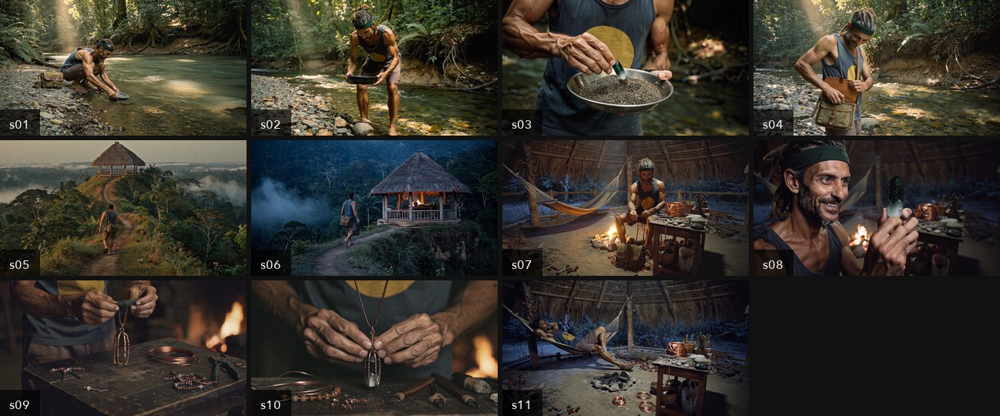
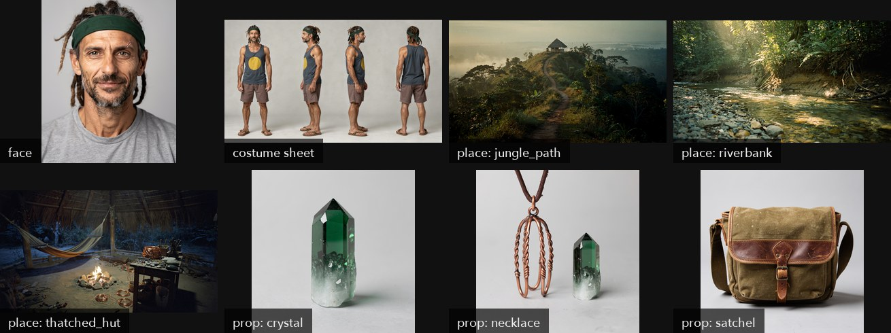
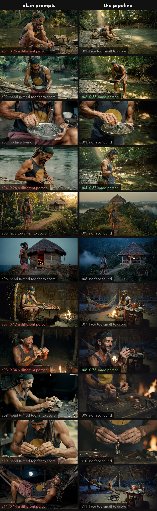

# flux-consistency-pipeline

**One character, eleven shots, the same man every time, and measured, not eyeballed.**

A Python pipeline that keeps a character, his costume, his props and his places on-model across
AI-generated shots made with [FLUX](https://bfl.ai) by Black Forest Labs: FLUX.2 [pro] for the stills,
FLUX 3 video for the motion. Every frame in this repo was generated by FLUX; ffmpeg, OpenCV and Pillow
only measure, cut and caption.

<!-- On github.com, drag assets/web/demo.mp4 (made by `fluxpipe report`) here to play it inline. -->
[](results/demo.mp4)

<sub>The side-by-side (25 s, [results/demo.mp4](results/demo.mp4)): the same shot, model, size and seed on both sides. Left, a
plain prompt; right, the pipeline. The number is the face match with one locked face; the closing card adds
the full film's background steadiness.</sub>

## The numbers

Face identity is measured with ArcFace (InsightFace `buffalo_l`): the cosine between two faces'
embeddings, where **0.5 or more means the same person**. Background jitter is measured with OpenCV and
calibrated on our own clips (details below).

<!-- generated:headline -->
| | Plain prompts | The pipeline |
|---|---:|---:|
| **Same man from shot to shot** (stills, every pair of judgeable shots: 5 plain, 3 pipeline) | best pair **0.37**: no two shots show the same man | worst pair **0.59**: every pair is the same man |
| **Face match with the locked face** (s04, s08: judgeable on both sides) | **0.30** | **0.71** |
| **Face in the finished film** (frames sampled at 2/s, every judgeable frame) | | **17 of 18** frames the same person |
| **Background jitter in the film** (under 0.5 px is steady) | | **10 of 11** shots steady, median **0.11 px** |
| **Total API spend**, every experiment included | | **$15.81** for 155 calls, 153 billed exactly as estimated |
<!-- /generated:headline -->

The plain prompts held the clothes (grey tank, mustard circle, pink shorts) but not the face, the
scar, the bandana, the crystal or the places. The comparison is fair by construction: same model,
size and seed; the only difference is what the pipeline adds.

## The film

<!-- On github.com, drag assets/web/film.mp4 here to play it inline. -->
[](results/film.mp4)

<sub>A 60 s rough cut ([results/film.mp4](results/film.mp4)): Ismael, a jewelry maker, finds a green crystal in a jungle river,
walks home to his hut on the ridge, sets it in a copper pendant by the fire and falls asleep wearing it.
3 shots are full renders, 8 are FLUX 3 drafts (the fast preview tier). Every clip is image-to-video
from its keyframe; one (s09) is trimmed before the point where its take breaks.</sub>

Per-shot QA of exactly what the cut plays (generated by `fluxpipe qa`; `fluxpipe report` copies it here):

<!-- generated:qa -->
| Shot | Render | Face (vs the locked face, 0.5+ = same person) | Background jitter | Camera |
|---|---|---|---|---|
| s01 | draft | too small or turned away in every frame: checked by eye | 0.01 px, steady | still |
| s02 | final | **same person**: worst 0.56, first 0.58 (3 of 10 frames judged) | 0.32 px, steady | drifts 50 px, pushes in 17% |
| s03 | draft | hands only, no face meant to be in frame | 0.11 px, steady | drifts 35 px, pushes in 6% |
| s04 | final | **same person in 4 of 5 frames**: worst 0.49, first 0.62 (5 of 10 frames judged) | 0.02 px, steady | still |
| s05 | draft | too small or turned away in every frame: checked by eye | 0.03 px, steady | drifts 12 px |
| s06 | draft | too small or turned away in every frame: checked by eye | 0.13 px, steady | drifts 20 px, pulls out 4% |
| s07 | draft | too small or turned away in every frame: checked by eye | 0.01 px, steady | still |
| s08 | final | **same person**: worst 0.63, first 0.74 (10 of 10 frames judged) | 0.57 px, slight jitter | drifts 76 px, pushes in 20% |
| s09 | draft | hands only, no face meant to be in frame | 0.14 px, steady | drifts 12 px, pushes in 2% |
| s10 | draft | hands only, no face meant to be in frame | 0.30 px, steady | still |
| s11 | draft | too small or turned away in every frame: checked by eye | 0.01 px, steady | still |

Face: 17 of 18 judged frames are the same person, across the 3 shots with a judgeable face (worst frame 0.49).
Background: 10 of 11 shots steady (jitter under 0.5 px; over 1.0 px is visible shake); median 0.11 px, worst 0.57 px.
<!-- /generated:qa -->

"Not judged" is not "passed": faces under 80 px, or turned more than 30° up/down or 60° sideways,
aren't scored, and those shots were checked by eye. s08's "slight" jitter is its push-in changing speed.

## How it works

```
story bible (YAML) -> locked references -> keyframes + face QA -> image-to-video -> clip QA -> cut
        \________________ every paid call is checked against a spend cap first ________________/
```

The idea is to treat a film like a software build. The story bible is the source code, generated
images are build artifacts, and QA is the test suite that catches drift before it costs more.

1. **A story bible with a strict schema.** `bible/` holds the character (identity, costume with
   measured hex colours), props, locations and the shot list as YAML. Unknown keys are errors.
   Every prompt is generated from one template as FLUX.2 structured JSON, so no shot re-types a description.
2. **Locked references, made in order.** The face first (text only: that's where the face is decided),
   then a four-view costume sheet that attaches the face, then empty location plates, then each prop as a
   product shot. Each shot attaches the ones it needs as image 1, 2, 3...
   <br>[](results/readme/refs.jpg)
3. **Keyframes with face QA.** Three FLUX.2 [pro] candidates per shot; ArcFace scores each against the
   locked face (pose-aware: a head turned too far isn't scored, as the score falls even for the same face);
   retries are capped at two rounds. Each pick stores a fingerprint of its request, so editing the bible
   or re-locking a reference shows exactly which shots are stale.
4. **Image-to-video, drafts first.** FLUX 3 video animates each keyframe from a *motion-only* prompt
   (what moves and what the camera does; the start frame already decides the look). A draft costs
   $0.06/s; only the keepers are enhanced at $0.15/s. Enhancing renders the same take sharper, but it
   doesn't change identity or motion, so those are judged at the draft.
5. **Clip QA.** Face identity on frames sampled at 2/s, read with head pose. Background jitter:
   OpenCV ORB features and RANSAC fit one camera motion per frame pair (points on the moving man are
   outliers), and jitter is how far the frame centre's path trembles around its 0.2 s smoothing.
   Calibration on our own clips: a frozen still measures 0.00 px, the same still shaken ±0.5 px measures
   0.74 px, ±2 px measures 2.6 px. Under 0.5 px is steady; over 1 px is visible shake.
6. **A ledger in front of every paid call.** SQLite writes the call's estimated cost *before* it is sent
   and refuses it if the spend cap would be passed; BFL's reported cost replaces the estimate afterwards.

<details>
<summary><b>All 11 stills: plain prompts vs the pipeline</b> (click to open)</summary>

[](results/readme/stills.jpg)

</details>

## What the generations taught

Each of these came from a real generation in this repo, and each one changed the pipeline.

- **References, not words, hold identity.** Attaching the face, costume sheet and plate took s02's face
  match from 0.27 (text only) to 0.81. Plain colour words were enough for the clothes; nothing in text
  was enough for a face, a specific object or a set.
- **A reference copies more than you meant.** The face portrait's grey t-shirt turned the costume's
  bright blue tank top slate grey. A location plate is copied as a camera position: every hut shot,
  close-ups included, took the plate's exact layout. Close-ups now leave the plate off.
- **A reference sets a prop's size, and a product shot has no scale.** The crystal came out palm-sized
  and then fist-sized, whatever the words said. The fix was a reference cropped from a shot that got it
  right, next to his fingertip (`prop_refs`), so the image carries the size as well as the look.
- **Every noun in a prompt gets drawn.** A leftover "lighthouse" put a lighthouse in the frame;
  "living in the jungle" put jungle in indoor shots. Describe what a camera sees, not the story.
- **Face scores fall when the head tips down, for the same face.** One draft went 0.80 → 0.39 as he
  looked into the pan, while by eye he never changed. Face QA now reads head pose and doesn't score
  faces turned beyond what the scorer has been shown to cope with on our own stills.
- **Video faces need more pixels than stills.** An 85 px face scored 0.61 as a PNG and 0.33–0.51 in
  h264. Identity is measured on medium shots and close-ups.
- **Video models don't know an object is rigid.** Told the copper cage "settles on the table", the
  model collapsed it into a tangle. Motion that sets down or drops a prop is now avoided, and a take that
  breaks late is trimmed in the bible (`cut_to`) so the cut rebuilds the same.
- **"The camera holds still" is mostly obeyed, and only measuring shows when it isn't.** s03 drifts
  35 px and pushes in 6%. Slow drifts read as a deliberate camera, so they're reported, not failed.

## Known flaws

- The light jumps from golden hour (s05) to blue night (s06), and the hut's design changes between them.
- The crystal's size varies: thumb-length in s03–s04, finger-length in s08. In s10 it reads clear, not green.
- The pan is black in s01–s02 and steel in s03.
- The hut interiors (s07, s11) read cold blue where firelight should be warm.
- 8 of the 11 shots are drafts, the fast preview tier.

## Cost

<!-- generated:costs -->
Every paid call's cost is worked out before it is sent, and the ledger refuses any call that would pass the spend cap. Of 155 calls, 153 were billed exactly as estimated (2 billed less). Total: **$15.81**, every experiment included.

The money went where problems are cheapest to catch. **$6.43** bought 72 keyframe candidates for 11 picks: stills at about $0.09 each, scored before anything moves. **$7.20** went on video: 14 drafts at $0.30, and 4 full renders at $0.75, paid for only after a draft had passed.

<details>
<summary>Spend by stage</summary>

| Stage | Model | Calls | Estimated | Billed | Billed exactly as estimated |
|---|---|---:|---:|---:|---:|
| API checks | flux-2-klein-4b, flux-2-pro | 2 | $0.04 | $0.04 | 2 of 2 |
| Reference candidates (8 locked) | flux-2-pro | 38 | $1.29 | $1.26 | 36 of 38 |
| Plain-prompt baseline stills | flux-2-pro | 21 | $0.63 | $0.63 | 21 of 21 |
| Keyframe candidates (11 picked) | flux-2-pro | 72 | $6.43 | $6.43 | 72 of 72 |
| Edits (tried; none used) | flux-2-pro | 4 | $0.24 | $0.24 | 4 of 4 |
| FLUX 3 video: drafts and finals | flux-3-video | 18 | $7.20 | $7.20 | 18 of 18 |
| **Total** | | **155** | **$15.84** | **$15.81** | **153 of 155** |

</details>
<!-- /generated:costs -->

## Run it

```bash
python3 -m venv .venv && source .venv/bin/activate
pip install -e ".[dev,qa]"
cp .env.example .env              # add a BFL API key; DRY_RUN=true logs calls without sending them

fluxpipe validate                 # check the story bible
fluxpipe prompts --shot s04 --as json   # the exact request a shot will send
fluxpipe keyframes                # candidates for every stale shot, scored and picked
fluxpipe video s04                # an image-to-video draft of a shot's keyframe
fluxpipe video s04 --enhance s04_draft1.mp4   # render a kept draft at full quality
fluxpipe qa                       # face + background QA of every clip the cut uses
fluxpipe cut                      # the rough cut, from clips of the current picks
fluxpipe demo                     # the side-by-side with scores
fluxpipe report                   # this README's figures and cost table
fluxpipe budget                   # spend so far against the cap
pytest
```

Every command that spends money says what it will cost first and goes through the ledger; with
`DRY_RUN=true` nothing is sent. QA, cutting and reporting are free and run locally.

| Path | What it is |
|---|---|
| `bible/` | Characters, locations, props and the shot list (YAML); locked references in `bible/refs/` |
| `src/fluxpipe/prompts.py` | Builds every prompt from the bible |
| `src/fluxpipe/bfl_client.py` | The only code that talks to the BFL API |
| `src/fluxpipe/ledger.py` | SQLite log of every paid call; enforces `SPEND_CAP_USD` |
| `src/fluxpipe/qa/` | Face identity (`face.py`), clip sampling (`video.py`), background jitter (`background.py`) |
| `src/fluxpipe/video.py`, `cut.py`, `demo.py`, `report.py` | Image-to-video, the cut, the side-by-side, the README evidence |
| `results/` | Everything shown here: stills, picks with every candidate's score, clips, QA, videos |
| `assets/` | Every candidate and draft, and the ledger (git-ignored) |

## Licensing

InsightFace's pretrained `buffalo_l` models, used for face QA, are licensed for non-commercial research use.
